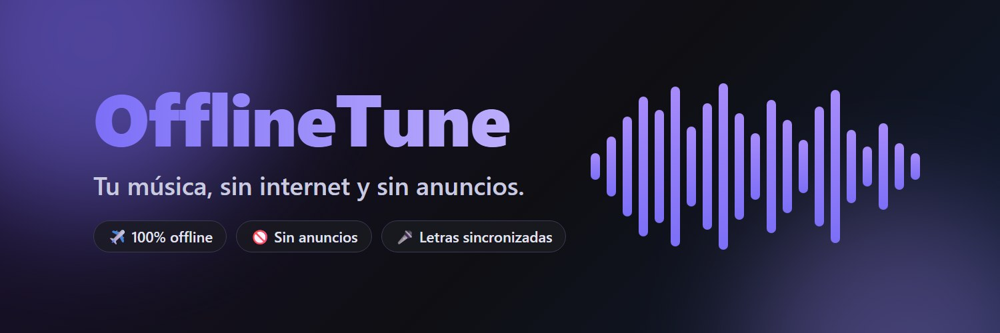
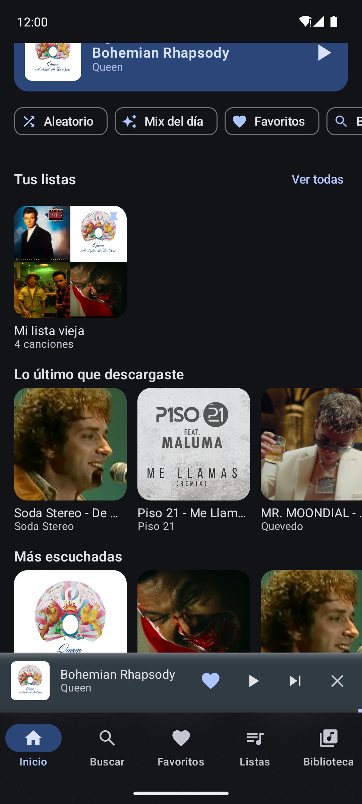
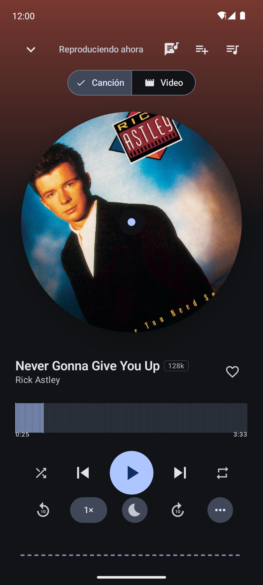
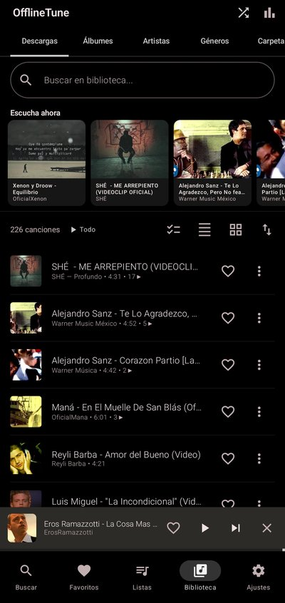
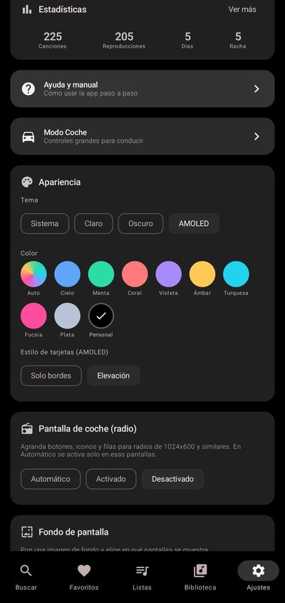
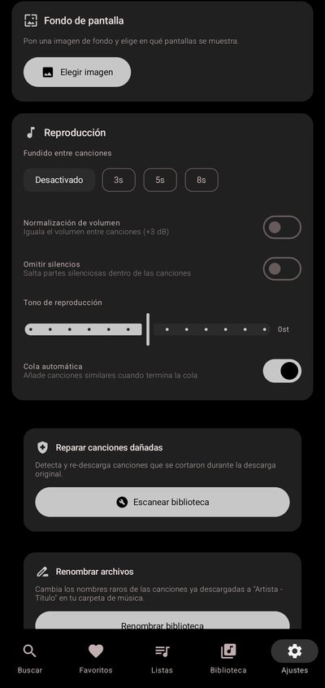

<p align="center">
  
</p>

<p align="center">
  <a href="https://github.com/aceIHeiI/OfflineTune/releases/latest"></a>
  <a href="https://github.com/ImranR98/Obtainium"></a>
  <a href="https://ko-fi.com/iheii"></a>
</p>

<p align="center">
  
  
</p>

**OfflineTune** es un reproductor de música para Android pensado para escuchar **sin datos móviles**: en el metro, en el gimnasio, de viaje o en el coche.

✅ Sin anuncios  ✅ Sin suscripciones  ✅ Sin límite de canciones

## 📱 Capturas

<p align="center">
  
  
  
  
</p>

<p align="center">
  
  
  
</p>

## ✨ Funciones

- ✈️ **100% offline** — tu música se reproduce sin conexión.
- 🎬 **Videos** — modo Canción | Video en Buscar, pantalla completa, subtítulos, mini reproductor e imagen en imagen.
- 🏠 **Inicio** — seguir escuchando, Mix del día, tus listas y lo último que agregaste.
- ✨ **Efecto cristal** en la barra de abajo (se puede apagar).
- 📱 **Widget** con controles, progreso y el color de la portada.
- 📂 **Importa tu música** — agrega los MP3/M4A que ya tienes en el teléfono.
- 🎤 **Letras sincronizadas** que se resaltan mientras suena la canción.
- 📊 **Forma de onda interactiva** — toca cualquier punto para saltar ahí.
- 🚗 **Modo Coche** con controles grandes, y modo especial para **estéreos Android de 1024×600**.
- 🎨 **Temas** Claro, Oscuro y AMOLED, con 9 colores o uno personalizado.
- 📋 **Listas inteligentes** — más escuchadas, añadidas recientemente, sin escuchar.
- 📈 **Estadísticas** de reproducción y racha de días.
- 🔊 **Volumen parejo** — normalización real: todas tus canciones suenan igual de fuerte.
- 💾 **Copia de seguridad** — exporta tu biblioteca y recupérala con un botón en otro teléfono.
- 🌎 **Español / English** — cambia el idioma desde Ajustes.
- 🔔 **Descargas masivas tranquilas** — de 3 en 3, con un solo aviso y botón para cancelar.
- 🎚️ Fundido entre canciones, velocidad y temporizador para dormir.
- ⏯️ Recuerda en qué parte de cada canción te quedaste.

## ⬇️ Instalación

1. Ve a **[Releases](https://github.com/aceIHeiI/OfflineTune/releases/latest)** y descarga el archivo `.apk`.
2. Ábrelo en tu teléfono y permite instalar apps de fuentes desconocidas si te lo pide.
3. Para actualizar, instala la versión nueva encima: **no pierdes tus canciones**.

### 🔔 Actualizaciones

Desde la **v2.2.4** la app te avisa cuando hay una versión nueva y puedes actualizarla en **Ajustes › Acerca de › Buscar actualización**.

También puedes usar **[Obtainium](https://github.com/ImranR98/Obtainium)**: instálalo, toca **Agregar app** y pega:

```
https://github.com/aceIHeiI/OfflineTune
```

Obtainium te avisará cada vez que salga una versión nueva.

## 💬 ¿Errores o ideas?

Abre un **[Issue](https://github.com/aceIHeiI/OfflineTune/issues)** y cuéntame qué pasó o qué te gustaría ver. ¡Leo todos!

## ☕ Apoya el proyecto

OfflineTune la hago yo solo en mi tiempo libre. Si te sirve, un café en **[Ko-fi](https://ko-fi.com/iheii)** me ayuda a mantenerla gratis y sin anuncios. 💜

## OfflineTune Car y Velora Drive

Para llevar tu música y tus videos al estéreo del coche:

**OfflineTune Car** es la edición de OfflineTune para el celular que se conecta con el estéreo. Descarga el archivo OfflineTune-Car en [Releases](https://github.com/aceIHeiI/OfflineTune/releases/latest). Solo se distribuye por GitHub.

**[Velora Drive](https://github.com/aceIHeiI/VeloraDrive)** es el launcher para estéreos Android que recibe la música, la portada y el video desde OfflineTune Car por el hotspot del celular.

No mires video ni uses el celular manejando.
