<p align="center">
  
</p>

<p align="center">
  <a href="https://github.com/aceIHeiI/OfflineTune/releases/latest"></a>
  <a href="https://github.com/ImranR98/Obtainium"></a>
  <a href="https://ko-fi.com/iheii"></a>
</p>

<p align="center">
  
  
</p>

**OfflineTune** es un reproductor de música para Android pensado para escuchar **sin datos móviles**: en el metro, en el gimnasio, de viaje o en el coche.

✅ Sin anuncios  ✅ Sin suscripciones  ✅ Sin límite de canciones

### ⬇️ ¿Qué descargo?

| Quiero… | Descargo |
|---|---|
| **Usar OfflineTune en mi celular** (lo que casi todos quieren) | **`OfflineTune-vX.apk`** en [Releases](https://github.com/aceIHeiI/OfflineTune/releases/latest). Es la app principal y no necesitas nada más. |
| **Llevar mi música y videos al estéreo Android del coche** (opcional) | Los complementos: `OfflineTune-Car-vX.apk` en el celular y [Velora Drive](https://github.com/aceIHeiI/VeloraDrive) en el estéreo. [Más abajo](#-opcional-llévala-al-coche) está la explicación. |

## 📱 Capturas

<p align="center">
  
  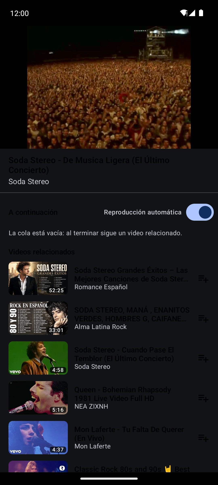
  
  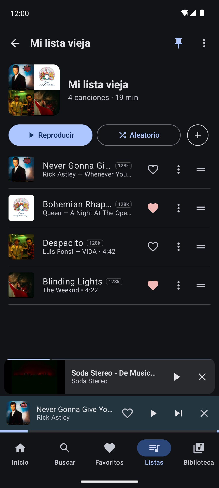
</p>

<p align="center">
  
  
  
</p>

<p align="center">
  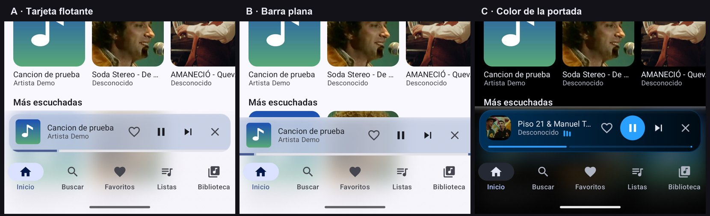
</p>

## ✨ Funciones

- 📺 **Video sobre Android Auto** — (opcional) con OfflineTune Car + Velora Drive, el video de tu celular se abre encima de Android Auto en el estéreo y, con un toque, se hace una ventanita flotante para que sigas viendo Google Maps.
- ✈️ **100% offline** — tu música se reproduce sin conexión.
- 🎬 **Videos** — modo Canción | Video en Buscar, pantalla completa, subtítulos, mini reproductor e imagen en imagen.
- 🏠 **Inicio** — seguir escuchando, Mix del día, tus listas y lo último que agregaste.
- 🎨 **Mini reproductor con 3 estilos** — tarjeta flotante, barra plana o **color de la portada** (el predeterminado, precioso en negro AMOLED). Se elige en Ajustes › Apariencia.
- ✨ **Efecto cristal** en la barra de abajo (se puede apagar).
- 📱 **Widget** con controles, progreso y el color de la portada.
- 📂 **Importa tu música** — agrega los MP3/M4A que ya tienes en el teléfono.
- 🎤 **Letras sincronizadas** que se resaltan mientras suena la canción.
- 📊 **Forma de onda interactiva** — toca cualquier punto para saltar ahí.
- 🚗 **Modo Coche** con controles grandes, y modo especial para **estéreos Android de 1024×600**.
- 🎨 **Temas** Claro, Oscuro y AMOLED, con 9 colores o uno personalizado.
- 📋 **Listas inteligentes** — más escuchadas, añadidas recientemente, sin escuchar.
- 📈 **Estadísticas** de reproducción y racha de días.
- 🔊 **Volumen parejo** — normalización real: todas tus canciones suenan igual de fuerte.
- 💾 **Copia de seguridad** — exporta tu biblioteca y recupérala con un botón en otro teléfono.
- 🌎 **Español / English** — cambia el idioma desde Ajustes.
- 🔔 **Descargas masivas tranquilas** — de 3 en 3, con un solo aviso y botón para cancelar.
- 🎚️ Fundido entre canciones, velocidad y temporizador para dormir.
- ⏯️ Recuerda en qué parte de cada canción te quedaste.

## ⬇️ Instalación

1. Ve a **[Releases](https://github.com/aceIHeiI/OfflineTune/releases/latest)** y descarga el archivo `.apk`.
2. Ábrelo en tu teléfono y permite instalar apps de fuentes desconocidas si te lo pide.
3. Para actualizar, instala la versión nueva encima: **no pierdes tus canciones**.

### 🔔 Actualizaciones

Desde la **v2.2.4** la app te avisa cuando hay una versión nueva y puedes actualizarla en **Ajustes › Acerca de › Buscar actualización**.

También puedes usar **[Obtainium](https://github.com/ImranR98/Obtainium)**: instálalo, toca **Agregar app** y pega:

```
https://github.com/aceIHeiI/OfflineTune
```

Obtainium te avisará cada vez que salga una versión nueva.

## 💬 ¿Errores o ideas?

Abre un **[Issue](https://github.com/aceIHeiI/OfflineTune/issues)** y cuéntame qué pasó o qué te gustaría ver. ¡Leo todos!

## ☕ Apoya el proyecto

OfflineTune la hago yo solo en mi tiempo libre. Si te sirve, un café en **[Ko-fi](https://ko-fi.com/iheii)** me ayuda a mantenerla gratis y sin anuncios. 💜

## 🚗 Opcional: llévala al coche

Esto es un **complemento**: la app principal es OfflineTune y funciona sola. Si además tienes un estéreo Android en tu coche, estos dos archivos la conectan con él: **OfflineTune Car** (en el celular) y **Velora Drive** (en el estéreo).

### 📺 Video sobre Android Auto, sin dejar el mapa

Manda un video de tu celular al estéreo y se abre **encima de Android Auto**. Con un toque lo conviertes en una **ventanita flotante** y sigues viendo **Google Maps** mientras suena. Si cambias de video o avanzas la lista desde el celular, la ventana **no se maximiza** ni te tapa el mapa.

<p align="center">
  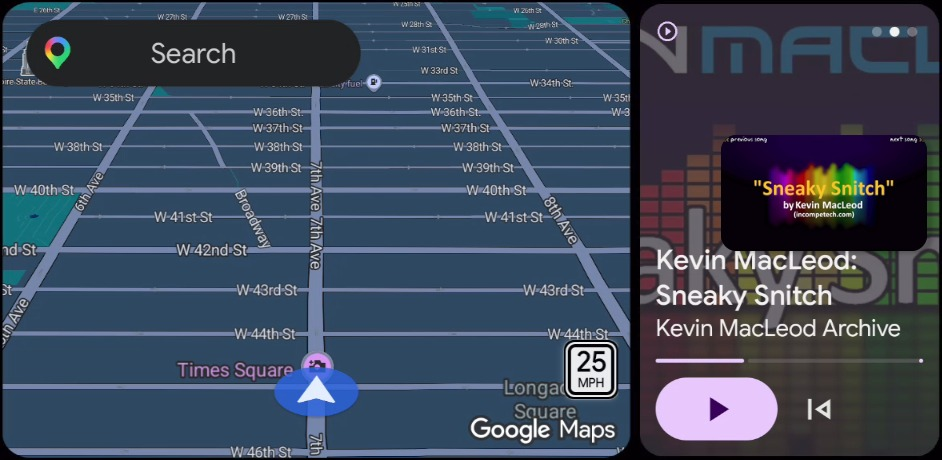
  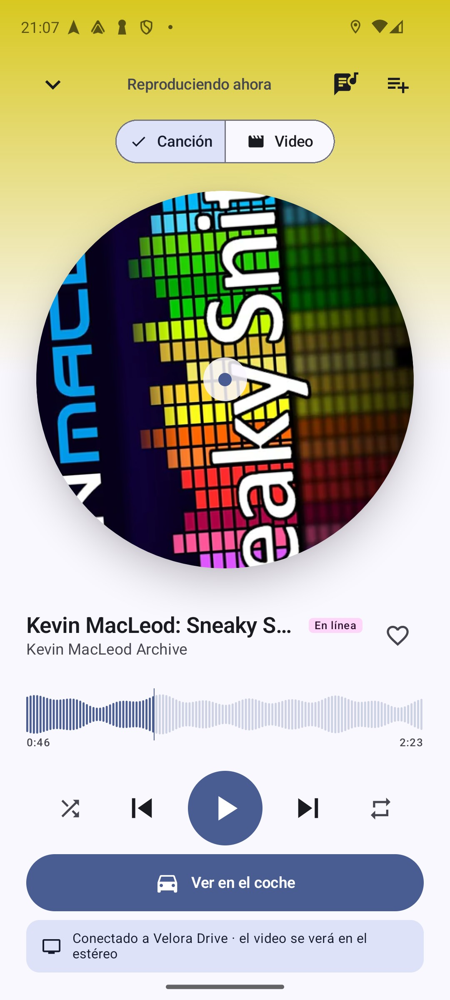
</p>

⚠️ Ve videos solo con el coche detenido.

Además de eso, lleva tu música y tus videos al estéreo Android de tu coche. **OfflineTune Car** corre en tu celular y **[Velora Drive](https://github.com/aceIHeiI/VeloraDrive)** es el launcher que va en el estéreo.

<p align="center">
  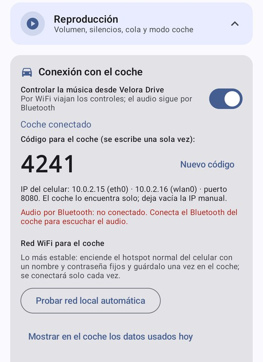
  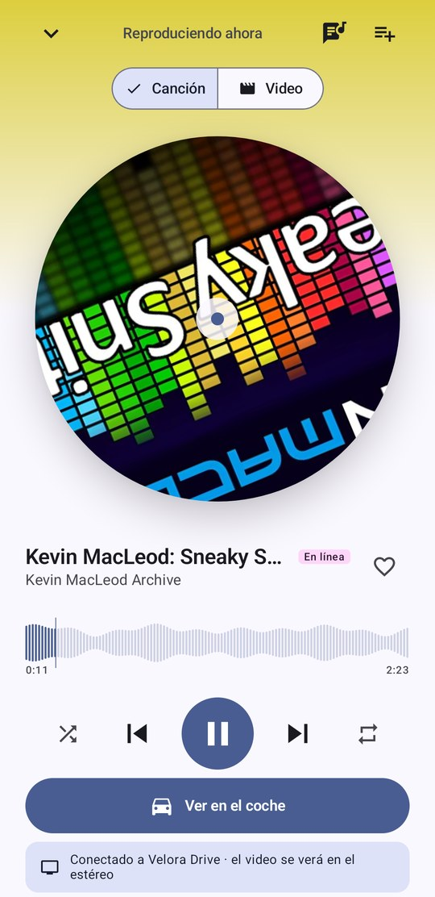
</p>
<p align="center">
  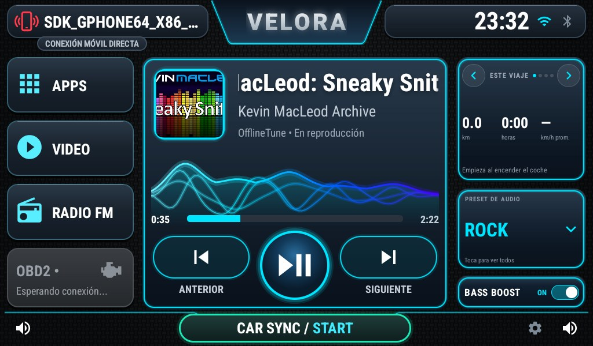
</p>

<p align="center">
  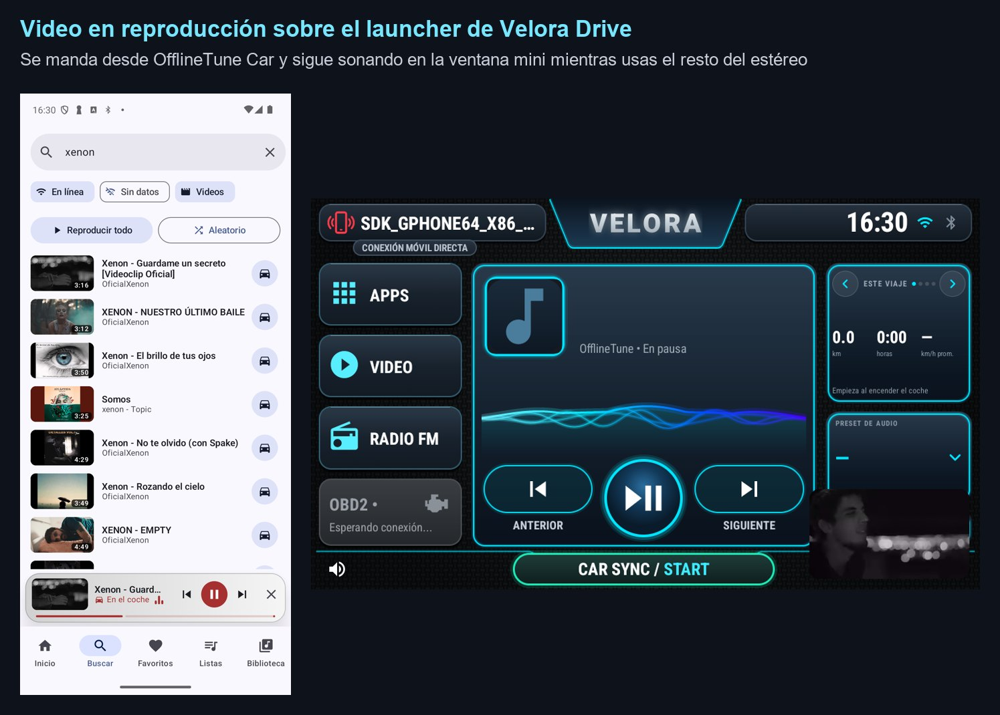
</p>
<p align="center">
  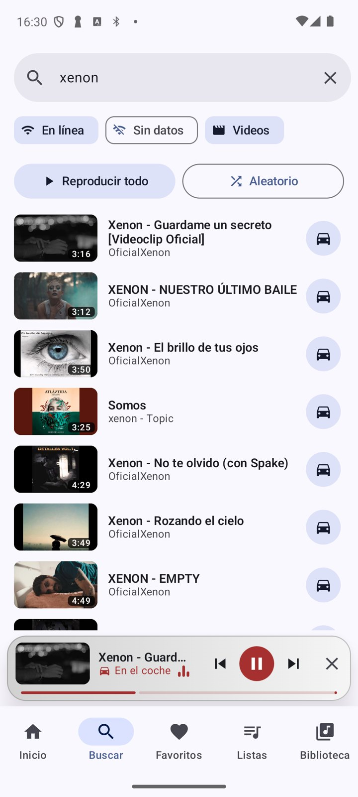
  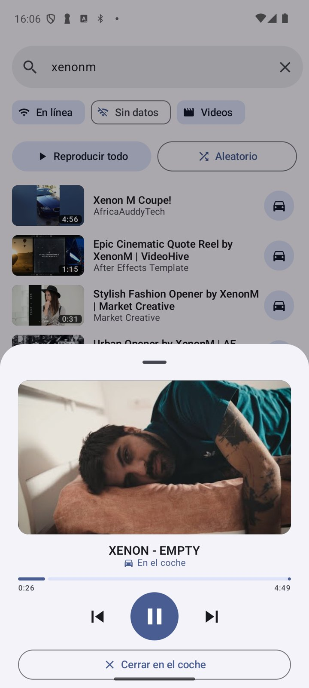
  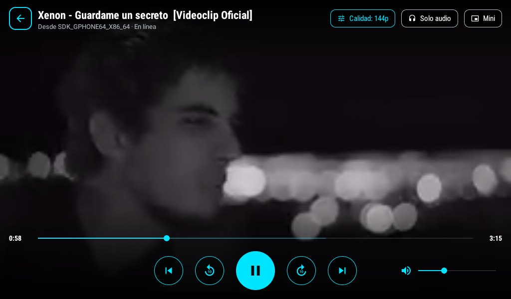
</p>

En **Buscar › Videos** toca **Reproducir todo** (o **Aleatorio**) y manda la lista al coche: el siguiente, el anterior y el fin de cada video siguen esa lista. Al tocar el mini reproductor del celular se abre una hoja con lo que está sonando en el coche, y la X lo cierra también en el estéreo. Si dejas el video en la ventana mini de Velora, al cambiar de video no se maximiza.

### Cómo conectarlos (solo la primera vez)

1. **Instala** [OfflineTune Car](https://github.com/aceIHeiI/OfflineTune/releases/latest) (`OfflineTune-Car-v….apk`) en el celular y [Velora Drive](https://github.com/aceIHeiI/VeloraDrive/releases/latest) en el estéreo.
2. **Pon el celular y el estéreo en la misma red WiFi.** Lo más estable: enciende el *hotspot* del celular con un nombre y contraseña fijos y guárdalo una vez en el estéreo.
3. En el celular abre OfflineTune Car y ve a **Ajustes › Reproducción › Conexión con el coche**. Deja el interruptor encendido y apunta el **código de 4 dígitos**.
4. En el estéreo abre Velora Drive, entra a **Ajustes › Celular** y escribe ese código.
5. **Conecta el Bluetooth del celular al estéreo** (el audio sale por Bluetooth).

Listo: Velora dirá "Conectado" y verás la canción, la portada y el progreso. Desde el estéreo puedes pausar, cambiar de canción, subir el volumen, elegir un preset de audio y encender el Bass Boost.

### Qué viaja por dónde

- **Bluetooth:** el sonido de la música (igual que cualquier celular con un estéreo).
- **WiFi:** solo los controles, el nombre de la canción, la portada y el video. Todo se queda en tu red local; no pasa por internet.
- **Video:** en el reproductor toca **Ver en el coche** y el video se abre en el estéreo. Empieza en calidad mínima (144p) para no trabarse y puedes cambiarla desde el estéreo. Úsalo solo con el coche detenido.

### Si algo no funciona

- **"Código incorrecto":** vuelve a escribir el código tal como aparece en el celular. Si pulsaste *Nuevo código*, hay que escribir el nuevo.
- **"Reconectando…":** el estéreo conserva la última canción y reintenta solo. Revisa que el celular siga en la misma red y que OfflineTune Car no esté cerrada por el ahorro de batería.
- **No hay sonido:** el audio no va por WiFi. Conecta el Bluetooth del celular al estéreo.

✅ **Probado en un celular y un estéreo Android reales.** Si encuentras algo raro, cuéntame en un [Issue](https://github.com/aceIHeiI/OfflineTune/issues).

No mires video ni uses el celular manejando.
